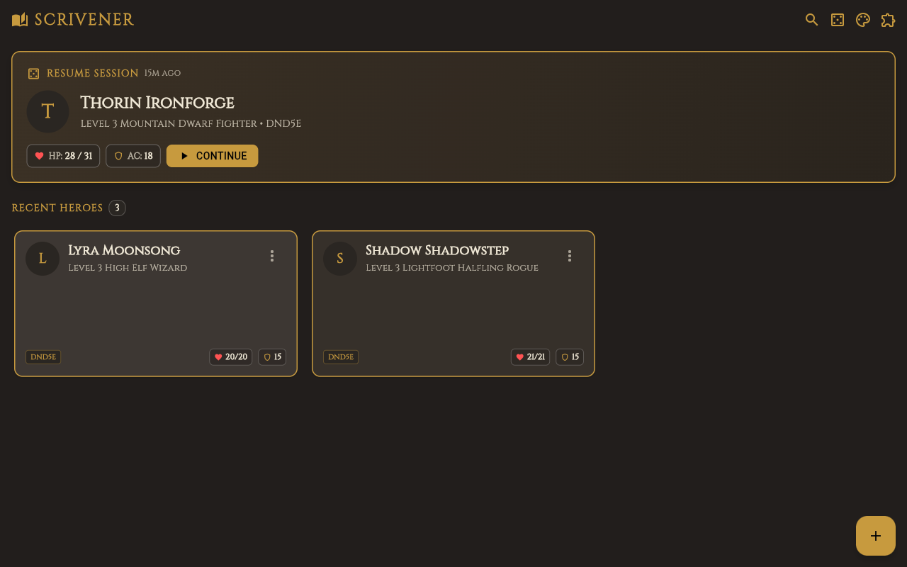
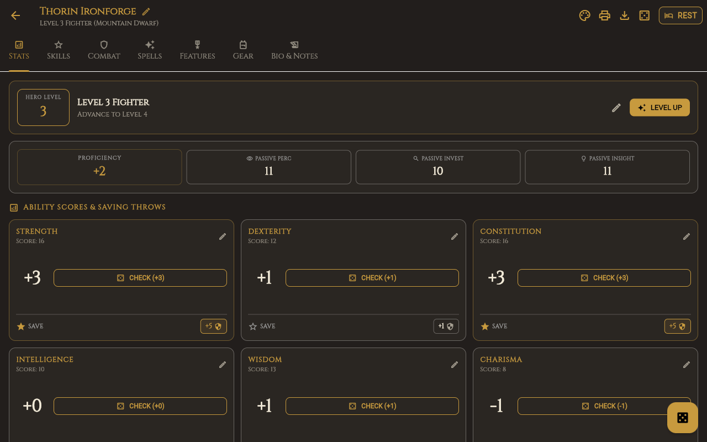
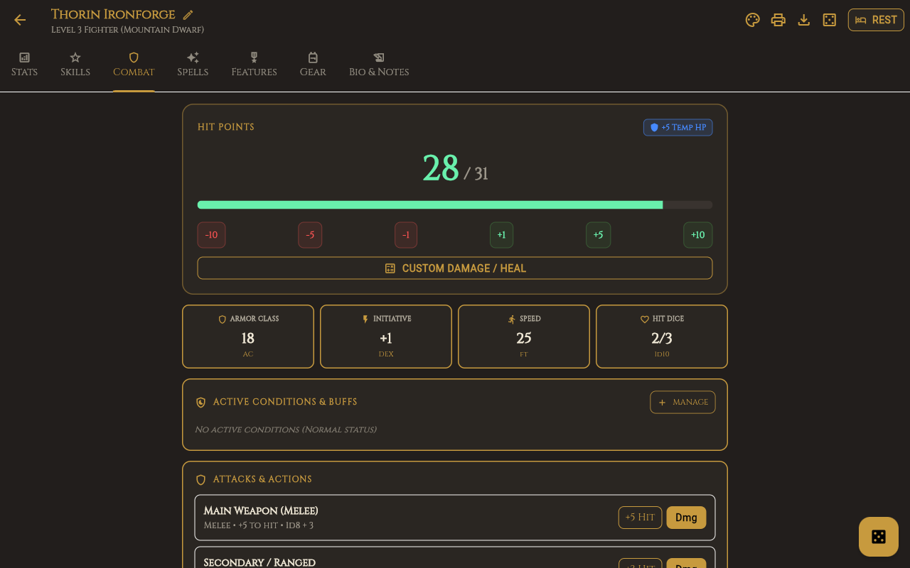
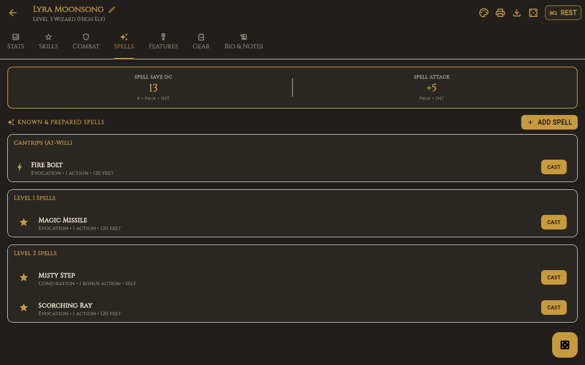
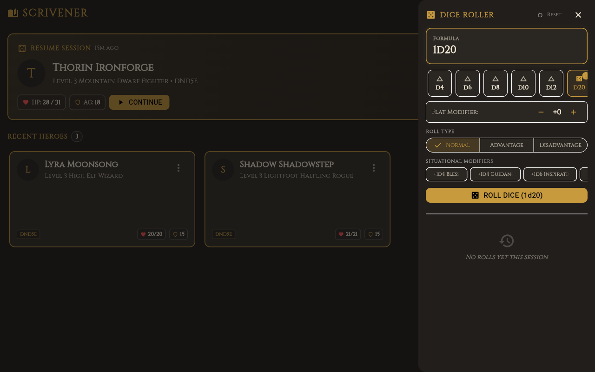
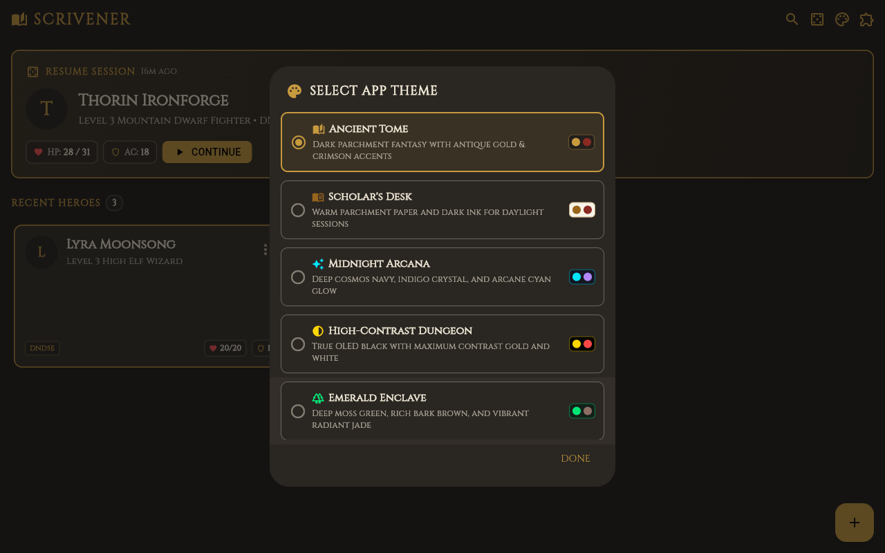
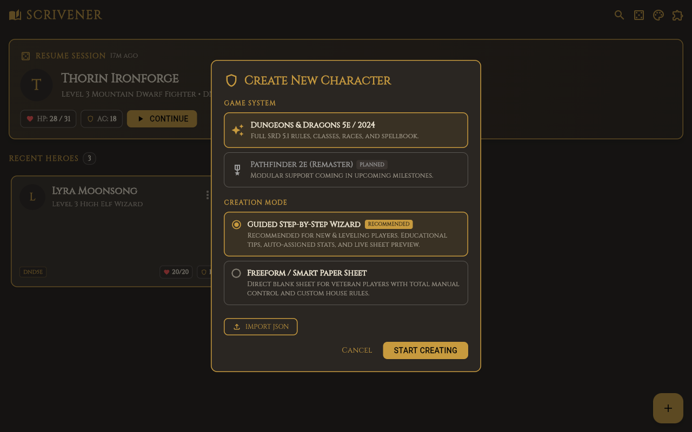
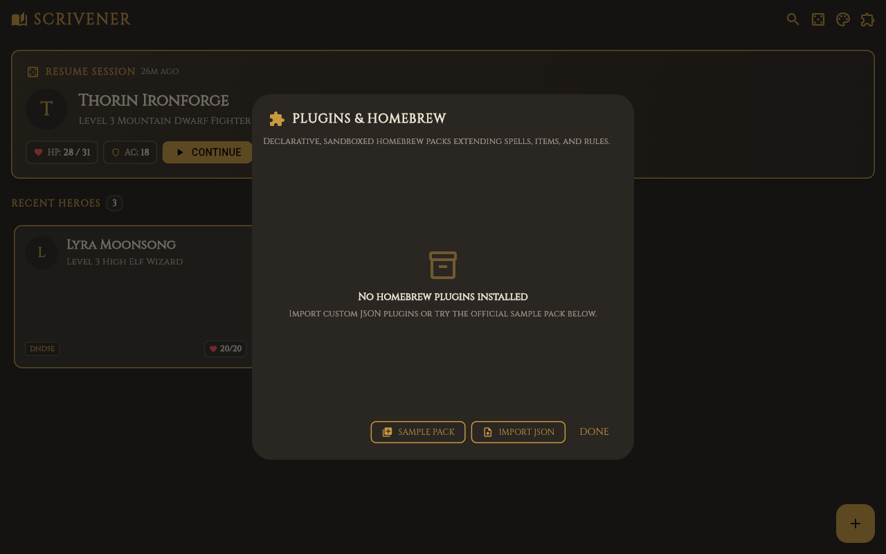
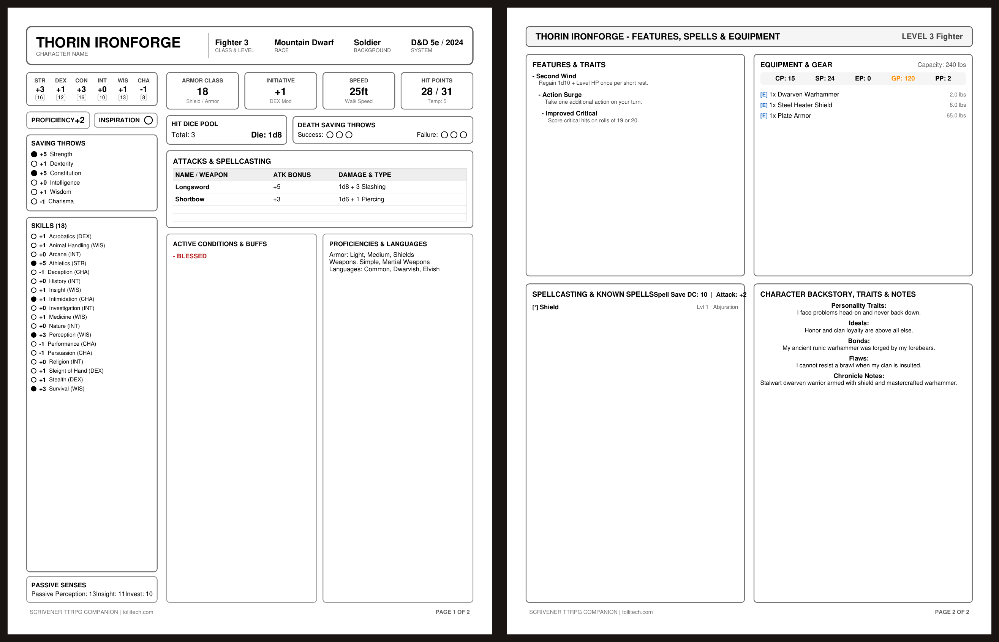
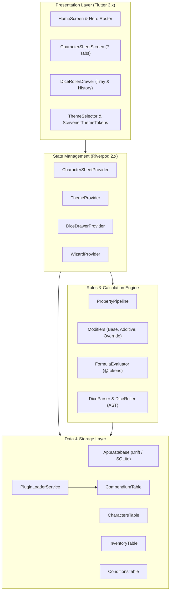

# Scrivener — Modern TTRPG Character Manager & Rules Engine

<p align="center">
  
</p>

<p align="center">
  <strong>A high-performance, modular companion app for tabletop roleplaying games. Built for mobile, desktop, and web.</strong>
</p>

<p align="center">
  
  
  
  
  
  
</p>

---

## Overview

**Scrivener** is an offline-first tabletop roleplaying companion application designed for players, dungeon masters, and game architects. Whether rolling dice during an intense boss encounter on your phone, managing character leveling on a tablet, or building homebrew compendiums on a desktop workstation, Scrivener combines digital speed with the tactile charm of traditional pen-and-paper gaming.

### Core Philosophy
- **Mathematical Accuracy Without Clutter**: Derived statistics (Armor Class, spell save DCs, attack bonuses, and skill proficiencies) evaluate through a dedicated modifier pipeline (`PropertyPipeline`) with stacking bonuses, hard overrides, and formula parsing.
- **Offline First & Private**: Your characters, homebrew packs, and roll logs live locally in SQLite via Drift. No forced cloud accounts, no subscriptions, and zero external network dependency required.
- **System Modularity**: Ships with an out-of-the-box D&D 5e / 2024 SRD ruleset while exposing an extensible `SystemContract` for Pathfinder 2e, Shadowdark, and custom homebrews.
- **Atmospheric Aesthetic**: Six built-in visual themes tailored for different session lighting conditions—from dark parchment fantasy to true OLED black and glowing celestial indigo.

---

## Visual Feature Tour

### 1. Hero Roster & Character Management
Manage active campaigns and multiple adventuring parties with responsive hero cards, real-time vital stats, last-played timestamps, and neutral title-bar dice rolling.

<p align="center">
  
</p>

---

### 2. 7-Tab Dynamic Character Sheet
Inspect ability scores, modifier pills, saving throws with proficiency stars, passive senses, and in-sheet leveling at a single glance.

<p align="center">
  
</p>

---

### 3. Combat & Vitality Dashboard
Track current hit points with dynamic color-coded health bars, temporary HP badges, one-tap health adjustments, death saving throw counters, active conditions (Blinded, Charmed, Blessed, Exhaustion), and weapon attacks.

<p align="center">
  
</p>

---

### 4. Spellcasting & Slot Management
Track spell save DCs and attack bonuses calculated dynamically from your spellcasting ability. Expend and restore spell slots per tier (Cantrips through 9th level) and cast spells directly with roll triggers.

<p align="center">
  
</p>

---

### 5. Interactive Dice Roller & Syntax Parser
A mathematical dice parser and interactive dice tray. Supports advantage, disadvantage, drop-lowest, keep-highest, situational bonuses (Bless, Guidance), natural 20 critical detection, and comprehensive roll history. Available globally via the AppBar quick-roller or inside character sheets.

<p align="center">
  
</p>

---

### 6. Visual Theme Engine & Per-Character Overrides
Switch seamlessly across six hand-crafted aesthetic themes. Each character can adopt a custom theme override to match their aesthetic (e.g. Infernal Brimstone for a Fiend Warlock, Emerald Enclave for a Circle of the Moon Druid).

<p align="center">
  
</p>

---

### 7. Dual Creation Modes: Guided Wizard & Smart Paper
Create characters either through a beginner-friendly 4-step guided wizard (Concept, Class, Gear, Ability Scores via Standard Array, Point Buy, or 4d6dl1 rolling) or instant freeform "Smart Paper" mode for rapid homebrew entry and NPCs.

<p align="center">
  
</p>

---

### 8. Declarative Sandboxed Plugins
Safely import and share custom homebrew packs containing spells, weapons, armor, and traits using data-driven JSON plugins injected directly into the local SQLite compendium.

<p align="center">
  
</p>

---

### 9. 2-Page Printable Character Sheet PDF Export
Export your characters as clean, publication-quality 2-page PDFs formatted for standard US Letter or A4 printing. Includes all attributes, attacks, inventory, spells, features, backstory, and condition trackers.

<p align="center">
  
</p>

---

## Architecture & System Design

Scrivener uses a layered architecture separating reactive state management, mathematical evaluation, data persistence, and platform presentation.



### Key Components
1. **[PropertyPipeline](lib/core/engine/property_pipeline.dart)**: Evaluates dynamic attributes through priority-sorted modifiers:
   - `base`: Initial unaugmented score (e.g. Base STR 15).
   - `additive`: Numerical adjustments (+2 Shield, +1 magic ring).
   - `override`: Absolute hard set (e.g. *Gauntlets of Ogre Power* locking STR to 19).
2. **[FormulaEvaluator](lib/core/engine/formula_evaluator.dart)**: Parses mathematical formulas containing `@variable` references (e.g. `@dex_mod + 10`).
3. **[DiceParser](lib/core/dice/dice_parser.dart)**: Translates dice notation strings (`2d20kh1+5`, `4d6dl1+2`) into an abstract syntax tree executed deterministically.
4. **[AppDatabase](lib/core/database/app_database.dart)**: SQLite relational schema with reactive streams for characters, inventory, conditions, and compendium records.

---

## Getting Started

### Prerequisites
- [Flutter SDK](https://flutter.dev/docs/get-started/install) 3.12.x or later
- [Dart SDK](https://dart.dev/get-dart) 3.12.x or later
- Linux build dependencies (for Linux desktop): `clang`, `cmake`, `ninja-build`, `pkg-config`, `libgtk-3-dev`
- Chrome or Chromium (for web development and automated testing)

### Installation & Run

1. **Clone the repository**:
   ```bash
   git clone https://github.com/robb/scrivener.git
   cd scrivener
   ```

2. **Install Flutter dependencies**:
   ```bash
   flutter pub get
   ```

3. **Generate Drift SQLite code**:
   ```bash
   dart run build_runner build --delete-conflicting-outputs
   ```

4. **Launch the application**:
   ```bash
   # Desktop Linux
   flutter run -d linux

   # Web browser
   flutter run -d chrome

   # Mobile (Android or iOS simulator)
   flutter run
   ```

---

## Verification & Testing

Scrivener enforces strict code quality standards with zero static analysis warnings and complete automated test coverage:

```bash
# Analyze Dart source code for static lints and warnings
flutter analyze

# Run all automated test suites
flutter test

# Format codebase according to Dart style conventions
dart format lib test
```

---

## Documentation Hub

Detailed developer and user guides are organized in the [`docs/`](docs/) directory:

| Document | Purpose |
| :--- | :--- |
| [**Docs Hub Index**](docs/README.md) | Central table of contents and documentation sitemap |
| [**Getting Started Guide**](docs/user-guide/getting-started.md) | First launch, roster management, and character creation workflows |
| [**Character Sheet Mastery**](docs/user-guide/character-sheet.md) | Deep dive into all 7 tabs, leveling, HP, death saves, and rests |
| [**Dice Roller Reference**](docs/user-guide/dice-roller.md) | Syntax reference (`kh`, `dl`, compound dice), presets, and roll history |
| [**Export, Backup & PDF Guide**](docs/user-guide/export-and-backup.md) | JSON backup/restore, offline persistence, QR sharing, and 2-page PDF export |
| [**Plugin Architecture**](docs/plugins/plugin-architecture.md) | Sandboxed declarative plugin design and SQLite injection lifecycle |
| [**Plugin Manifest Spec**](docs/plugins/manifest-spec.md) | Full JSON schema definition for `PluginManifest` |
| [**Authoring Compendiums**](docs/plugins/authoring-compendiums.md) | Step-by-step tutorial for authoring custom spells, items, and features |
| [**Authoring TTRPG Systems**](docs/plugins/authoring-systems.md) | `SystemContract` interface and modular ruleset extensions |
| [**Plugin Packaging & Distribution**](docs/plugins/packaging-and-distribution.md) | Packaging, testing, importing, and sharing homebrew packs |
| [**Theme Architecture**](docs/themes/theme-architecture.md) | Token system, typography, iconography, and Riverpod theme state |
| [**Built-in Themes Profile**](docs/themes/builtin-themes.md) | Palette tables, typography, and tokens for all 6 built-in themes |
| [**Authoring Custom Themes**](docs/themes/authoring-custom-themes.md) | Step-by-step guide to writing custom theme extensions and icon bundles |
| [**Per-Character Theming**](docs/themes/per-character-theming.md) | Individual theme overrides and responsive navigation styling |

---

## Developer Guide & Agent Instructions

For AI coding agents and human contributors, see [`AGENTS.md`](AGENTS.md) for architectural rules, responsive design constraints, state management conventions, and property pipeline guidelines.

---

## Author & Copyright

- **Author**: Robert Tolliver
- **Website**: [tollitech.com](https://tollitech.com)
- **Bundle Identifier**: `com.tollitech.scrivener`
- **Copyright**: © 2026 Robert Tolliver (tollitech.com).

---

## License & Legal Attributions

- **Software License**: Scrivener is licensed under the [Mozilla Public License 2.0 (MPL-2.0)](LICENSE).
- **D&D 5e SRD 5.1 Content**: This work includes material taken from the System Reference Document 5.1 ("SRD 5.1") by Wizards of the Coast LLC and available at [dnd.wizards.com](https://dnd.wizards.com/resources/systems-reference-document). The SRD 5.1 is licensed under the [Creative Commons Attribution 4.0 International License (CC-BY-4.0)](https://creativecommons.org/licenses/by/4.0/legalcode).
- **Third-Party Notices**: See [NOTICE](NOTICE) for font licenses and dependency details.
