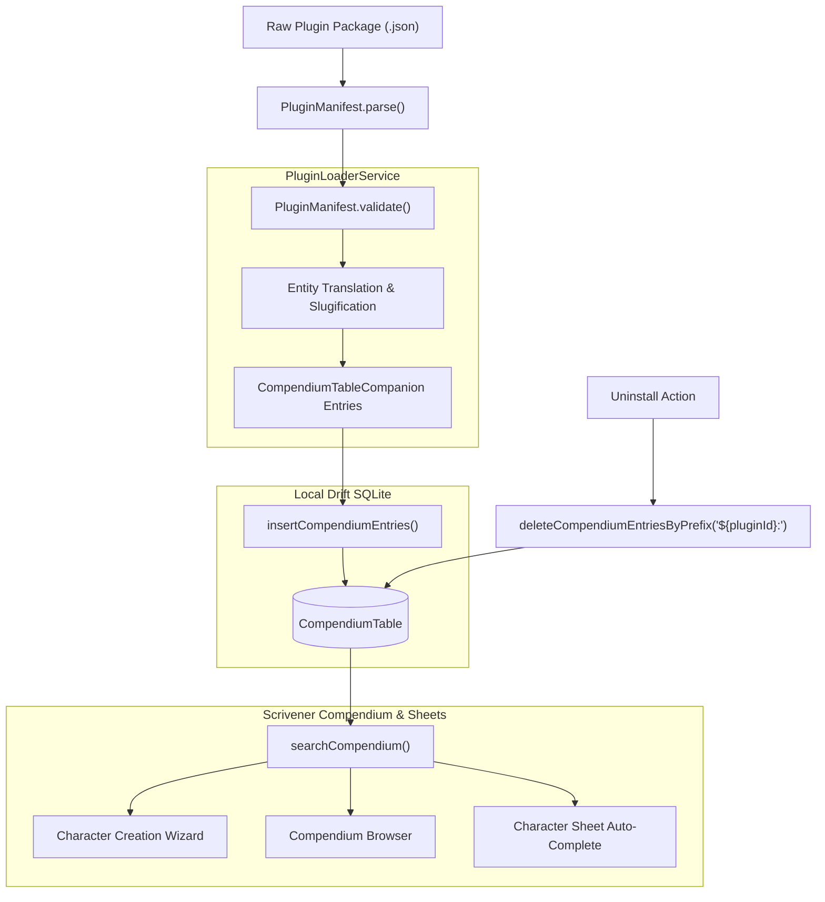

# Plugin Architecture & Sandboxed Design

Scrivener provides an extensible, declarative plugin architecture designed specifically for the security and reliability demands of modern applications. This guide explains the core principles behind Scrivener's plugin system and how homebrew content is integrated into the local database.

> [!NOTE] What Does "Homebrew" Mean in TTRPGs?
> In tabletop roleplaying games like D&D and Pathfinder, **"homebrew"** refers to custom, unofficial content created by players or Game Masters—such as original spells, magical weapons, subclasses, or house rules. 
> It is completely separate from and unrelated to the macOS/Linux `brew` package manager.

---

## 1. Declarative, Sandboxed Principles

Many plugin systems allow running arbitrary executable code or dynamic scripts (e.g. Lua, JavaScript, or dynamically loaded `.so` / `.dylib` binary libraries). While flexible, arbitrary code execution introduces severe security and stability risks:
- Malicious plugins could compromise user devices, steal data, or execute host shell commands.
- Script runtimes add memory bloat and degrade performance on mobile devices.
- Unhandled exceptions in plugin scripts could crash the host application during critical gameplay moments.

### Scrivener's Solution: Data-Driven Declarative Plugins
Scrivener plugins are strictly **declarative, data-driven packages**:
1. **No Executable Code**: Plugins declare structured data entities (spells, items, equipment, class features, rules).
2. **Schema-Validated**: Plugins are parsed through strict JSON validation before anything is accepted.
3. **Database Injection**: Accepted entities are injected into Scrivener's local SQLite compendium table (`CompendiumTable`).
4. **Formula Safety**: Dynamic values (like `@dex_mod + 10`) evaluate inside Scrivener's sandboxed mathematical evaluator (`FormulaEvaluator`) without arbitrary script access.

---

## 2. Plugin Lifecycle & Data Flow



### Steps in the Lifecycle:
1. **Parsing**: The package string is parsed into a `PluginManifest` instance. Wrapped markdown code blocks (` ```json ... ``` `) are automatically stripped.
2. **Validation**: The manifest checks that all required metadata fields (`id`, `name`, `version`, `targetSystem`) are present and non-empty.
3. **Entity Generation**: Spells, items, and features defined in the `entities` dictionary are converted into `CompendiumTableCompanion` records.
4. **Namespacing**: To prevent collisions between multiple homebrew authors or official SRD content, every entity ID is automatically prefixed:
   $$\text{entityId} = \text{\$\{manifest.id\}} : \text{\$\{category\}} : \text{\$\{slug\}}$$
   *Example*: `eloria-homebrew-compendium:spell:elorian_moonfire`
5. **Database Transaction**: All entries are inserted into SQLite via an atomic batch operation (`b.insertAllOnConflictUpdate`).
6. **Clean Uninstallation**: When a user uninstalls a plugin, Scrivener deletes all compendium records matching the prefix `[pluginId]:%` in a single query, leaving zero orphaned records behind.

---

## 3. Supported Entity Categories

A single plugin package can register multiple categories of tabletop entities:

| Entity Category | Target Compendium Category | Description |
| :--- | :--- | :--- |
| `spells` | `spell` | Custom cantrips, leveled spells, rituals, and magical effects. |
| `items` / `equipment` | `item` | Weapons, armor, shields, wondrous items, rings, potions, and gear. |
| `features` | `feature` | Racial traits, class features, subclass archetypes, and feats. |

---

## Next Steps
- See the exact schema definitions in the [**Plugin Manifest Specification**](manifest-spec.md).
- Follow a step-by-step tutorial in [**Authoring Compendiums**](authoring-compendiums.md).
- Learn how to extend rulesets in [**Authoring TTRPG Systems**](authoring-systems.md).
