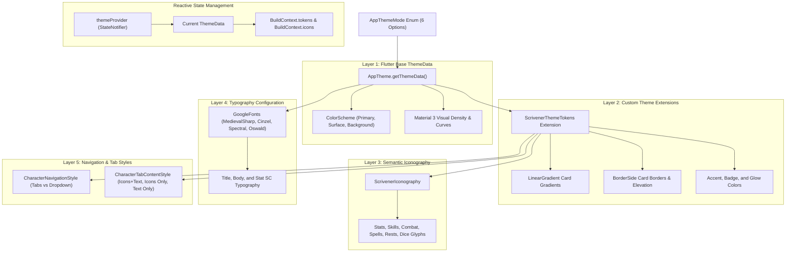

# Theme Architecture & Visual Token Engine

Scrivener features a multi-layered, tabletop-inspired design system engineered to deliver rich atmosphere across different physical session lighting conditions. This document explains the architecture of the theme engine, how visual tokens are attached to Flutter's `ThemeData`, and how reactive state management controls theme switching.

---

## 1. Visual Architecture Layers

Scrivener separates theme configuration into five distinct architectural layers:



---

## 2. The `ScrivenerThemeTokens` Extension

Flutter's standard `ThemeData` covers basic material styling, but tabletop apps require specialized artistic parameters such as parchment textures, gold foil card borders, and rune iconography.

Scrivener attaches a custom `ThemeExtension<ScrivenerThemeTokens>` to `ThemeData.extensions`:

```dart
class ScrivenerThemeTokens extends ThemeExtension<ScrivenerThemeTokens> {
  final LinearGradient cardGradient;
  final BorderSide cardBorder;
  final double cardRadius;
  final EdgeInsets cardPadding;
  final double cardElevation;
  final CharacterNavigationStyle navigationStyle;
  final CharacterTabContentStyle tabContentStyle;
  final ScrivenerIconography iconography;
  final String? fontFamily;
  final Color accentColor;
  final Color badgeColor;
  final Color badgeTextColor;

  const ScrivenerThemeTokens({
    required this.cardGradient,
    required this.cardBorder,
    required this.cardRadius,
    required this.cardPadding,
    required this.cardElevation,
    required this.navigationStyle,
    required this.tabContentStyle,
    required this.iconography,
    this.fontFamily,
    required this.accentColor,
    required this.badgeColor,
    required this.badgeTextColor,
  });

  @override
  ScrivenerThemeTokens copyWith({ ... });

  @override
  ScrivenerThemeTokens lerp(ThemeExtension<ScrivenerThemeTokens>? other, double t);
}
```

### Convenient `BuildContext` Extensions
Widgets access theme tokens cleanly using context extensions (`lib/core/theme/models/scrivener_theme_tokens.dart`):

```dart
extension BuildContextThemeX on BuildContext {
  ThemeData get theme => Theme.of(this);
  ColorScheme get colorScheme => Theme.of(this).colorScheme;
  ScrivenerThemeTokens get tokens =>
      Theme.of(this).extension<ScrivenerThemeTokens>() ?? ScrivenerThemeTokens.defaultTokens;
  ScrivenerIconography get icons => tokens.iconography;
}
```

---

## 3. Semantic Iconography Bundles (`ScrivenerIconography`)

Different themes demand distinct glyph styles. Rather than hardcoding `Icons.shield` in UI widgets, Scrivener maps app concepts through `ScrivenerIconography`:

```dart
class ScrivenerIconography {
  final IconData tabStats;
  final IconData tabSkills;
  final IconData tabCombat;
  final IconData tabSpells;
  final IconData tabFeatures;
  final IconData tabGear;
  final IconData tabBio;
  final IconData diceAction;
  final IconData restAction;
  final IconData themeSelector;
  final IconData checkAction;
  final IconData saveAction;
  ...
}
```

Built-in iconography presets include:
- `ScrivenerIconography.fantasy`: Rune and tabletop RPG inspired glyphs.
- `ScrivenerIconography.classic`: Scholarly, bookish library iconography.
- `ScrivenerIconography.arcana`: Astral, celestial, diamond, and flare glyphs.
- `ScrivenerIconography.dungeon`: Stark, tactical, geometric high-contrast glyphs.
- `ScrivenerIconography.nature`: Foliage, leaf, tree, and organic glyphs.
- `ScrivenerIconography.infernal`: Flame, volcanic, and fiendish glyphs.

---

## 4. Typography System

Scrivener uses Google Fonts with system fallback fonts to ensure seamless offline rendering:

- **Headers & Titles**: `MedievalSharp`, `Cinzel`, or `Playfair Display` (with fallback to `serif`).
- **Body & Editorial Text**: `Spectral`, `Roboto`, or `Merriweather` (with fallback to `sans-serif`).
- **Numerical & Stat Values**: `Alegreya SC` or `Oswald` (with fallback to `sans-serif`).
